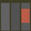
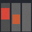

# Vision-to-Action Classification

A runnable computer-vision learning project: generate labelled navigation images, train a small PyTorch convolutional neural network, and predict one of four actions from pixels. OpenCV handles image generation, disk loading, colour conversion and resizing. NumPy provides image noise and evaluation metrics.

**Scope:** a synthetic three-lane teaching environment. This is not a trained autonomous robot or a real-world obstacle detector. All included images and benchmark results come from the documented generator; no camera dataset or physical robot was used.

## Example inputs

| Forward | Turn left | Turn right | Stop |
| --- | --- | --- | --- |
|  |  |  |  |

Red rectangles are obstacles. A clear lane does not have a red obstacle. The target rule is:

1. Choose `FORWARD` if the centre lane is clear.
2. Otherwise choose `TURN_LEFT` if the left lane is clear.
3. Otherwise choose `TURN_RIGHT` if the right lane is clear.
4. Otherwise choose `STOP`.

The rule generates training labels only; the neural network receives RGB pixels, not occupancy values. The class mix is balanced. Colours, obstacle sizes/positions and pixel noise vary by seed.

## Install

Use Python 3.10–3.12 (CPU is sufficient). Create the environment inside this project:

```bash
python -m venv .venv
source .venv/bin/activate
python -m pip install --upgrade pip
python -m pip install -r requirements.txt
```

On Windows, replace the activation command with `.venv\Scripts\activate` (Command Prompt) or `.venv\Scripts\Activate.ps1` (PowerShell).

PyTorch's standard installation can download GPU dependencies on Linux. For a CPU-only installation, install PyTorch first with `python -m pip install torch --index-url https://download.pytorch.org/whl/cpu`, then install the remaining requirements. No GPU or OpenCV graphical interface is required. Torchvision is intentionally not a dependency: this project uses its own CNN and the same explicit OpenCV transform for training and prediction.

## Generate, train and predict

Run commands from the repository root:

```bash
python main.py generate --train 2400 --validation 400 --test 400 --seed 42
python main.py train --epochs 8 --seed 42 --report reports
python main.py predict examples/turn_left.png
python main.py evaluate --split test
```

The dataset generator writes `data/manifest.json` and 3,200 PNGs in separate `train`, `validation` and `test` folders. Each manifest record preserves the image seed, label and occupancy pattern. Seed ranges are disjoint across splits, and loading the manifest checks for duplicate seeds, duplicate paths and inconsistent rule labels. Split sizes must be multiples of four. An existing manifest is never overwritten; use `--output data-another-run` for a fresh dataset.

Training prints one JSON record per epoch and writes:

- `outputs/model.pt`: checkpoint and label/preprocessing metadata;
- `outputs/metrics.json`: hyperparameters, environment, epoch history, test metrics and dataset fingerprint;
- `reports/metrics.json` and `reports/results.md`: the optional small, shareable benchmark report.

The best checkpoint is selected by validation cross-entropy. The untouched test split is evaluated only after checkpoint selection. Accuracy, macro F1, per-class precision/recall/F1 and a confusion matrix are reported. The training report also evaluates a constant-FORWARD baseline and a pixel-only OpenCV colour-threshold baseline; the latter uses fixed thresholds chosen for this documented generator. Re-running `evaluate` uses the selected checkpoint; it does not retrain the network. Probability outputs are not calibrated confidence guarantees.

The committed [measured report](reports/results.md) contains results from an actual run, with [full machine-readable metrics](reports/metrics.json). CPU timings vary, and numerical results can differ slightly across platforms or package versions.

For a quick smoke run in a different output folder:

```bash
python main.py generate --output data-smoke --train 64 --validation 16 --test 16
python main.py train --manifest data-smoke/manifest.json --output outputs-smoke --epochs 1
python main.py predict examples/stop.png --model outputs-smoke/model.pt
```

These tiny smoke datasets only exercise the pipeline; do not use their scores as evidence of model quality. `data-smoke` and `outputs-smoke` should not be committed.

## Model and shared preprocessing

Every image follows the same path for both training and inference:

`OpenCV BGR load → RGB conversion → 64 × 64 resize → float32 CHW tensor / 255 → CNN → logits`

The CNN uses `Conv(3,12) → ReLU → MaxPool → Conv(12,24) → ReLU → MaxPool → Linear(6144,64) → ReLU → Linear(64,4)`. Adam minimises cross-entropy. Training is seeded, uses deterministic PyTorch operations and runs on the CPU. Raw images and the occupancy manifest are kept separate from model inputs.

## Tests

```bash
python -m unittest discover -s tests -v
```

Tests cover all eight occupancy patterns, generator determinism, RGB channel order, identical training/prediction transforms, split balance and separation, invalid manifests, hand-calculated evaluation metrics, and a real tiny generate/train/checkpoint/reload/predict workflow. The integration test runs one short epoch; it checks the pipeline, not a promised accuracy threshold.

## Limits and next steps

The test set has new seeds but uses the same simple generator. A high score demonstrates learning the synthetic mapping, not generalisation to roads, rooms or cameras. The included colour-rule baseline can solve this toy environment without machine learning; the CNN exists to practise a complete vision-training workflow rather than to justify neural networks for this simple task.

Before considering real navigation, collect and annotate real camera data, create scene/location-disjoint evaluation splits, compare classical baselines, calibrate uncertainty and test safe failure handling. Turning this classifier into a robot controller would additionally require perception, planning, actuation and independent safety work.

No model weights, full datasets, environments or large generated outputs are tracked. Generate them locally with the commands above. The four tiny example images are generated independently with `python main.py examples` (seed `9000000000`).
